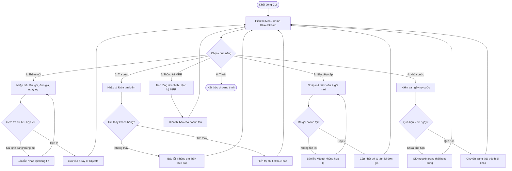

# BÁO CÁO BÀI TẬP: XÂY DỰNG HỆ THỐNG QUẢN TRỊ THUÊ BAO SAAS RIKKEISTREAM CLI

> 👤 **Học viên:** Hoàng Công Dũng | **Mã SV:** PTIT-HCM-009
> 🏫 **Môn học:** it103b-rl-HoangCongDung

---

## 📊 Sơ đồ thiết kế hệ thống (Flowchart)

> 💡 *Sơ đồ dưới đây được render tự động trực tiếp trên GitHub bằng Mermaid. Bạn cũng có thể tải file **`bt4.drawio`** trong repository này để mở và chỉnh sửa trực tiếp trên [Draw.io (diagrams.net)](https://app.diagrams.net).* 

---

## 1. Mục tiêu và Bối cảnh bài toán

Bài tập này yêu cầu tự tay xây dựng một ứng dụng dòng lệnh hoàn chỉnh bằng JavaScript để phục vụ bộ phận Chăm sóc khách hàng của nền tảng SaaS RikkeiStream.

Hệ thống quản lý thuê bao đa cấp bậc đòi hỏi cấu trúc dữ liệu Array of Objects chặt chẽ kết hợp với các hàm chức năng CRUD, đáp ứng đầy đủ các tiêu chí về Clean Code và Modular Function Architecture.

- Repository nộp bài trên GitHub Organization: 'it103b-rl-HoangCongDung'
- Tên file mã nguồn bắt buộc: 'solution_ex13.js'
- Đảm bảo menu tương tác tối thiểu 5 chức năng chính cộng với tính năng thoát chương trình.

## 2. Phân tích Quy tắc nghiệp vụ và Xử lý Edge Cases

Để ứng dụng vận hành mượt mà trong môi trường thực tế, tôi đã thiết kế sẵn sàng các phương án xử lý cho 3 bẫy dữ liệu (Edge Cases) thường gặp nhất:

Thứ nhất, xử lý lỗi nhập sai mã gói cước khi thực hiện nâng hoặc hạ cấp thuê bao. Hệ thống sẽ kiểm tra xem gói cước người dùng nhập có nằm trong danh mục hệ thống hay không trước khi tiến hành cập nhật đơn giá.

Thứ hai, xử lý tình trạng nợ cước quá hạn. Hệ thống tự động quét ngày nợ cước, nếu thời gian nợ vượt quá ngưỡng quy định (ví dụ trên 30 ngày), tài khoản sẽ tự động chuyển sang trạng thái bị khóa.

Thứ ba, xử lý trường hợp tìm kiếm không ra kết quả khi tra cứu thuê bao theo mã tài khoản hoặc tên khách hàng, tránh tình trạng chương trình bị crash do giá trị null.

- Bẫy 1: Nhập sai mã gói -> Bắt lỗi và yêu cầu nhập lại, không làm gián đoạn luồng.
- Bẫy 2: Nợ cước quá hạn -> Tự động đánh dấu khóa cước để CSKH dễ dàng xử lý.
- Bẫy 3: Không tìm thấy kết quả -> Thông báo rõ ràng 'Không tìm thấy thuê bao' kèm theo gợi ý.

## 3. Bảng đặc tả chi tiết các chức năng hệ thống CLI

Dưới đây là bảng tổng hợp các chức năng cốt lõi được hiện thực hóa trong mã nguồn JavaScript:

| Chức năng | Mô tả hành động | Dữ liệu đầu vào | Kết quả / Trạng thái |
| --- | --- | --- | --- |
| 1. Thêm mới | Thêm bản ghi khách hàng vào mảng thuê bao | Mã tài khoản, Tên, Gói cước, Đơn giá, Ngày nợ | Lưu thành công vào Array of Objects |
| 2. Tra cứu | Tìm kiếm thông tin thuê bao theo từ khóa | Mã tài khoản hoặc Tên khách hàng | Hiển thị thông tin chi tiết hoặc báo lỗi |
| 3. Nâng/Hạ cấp | Thay đổi gói cước dịch vụ hiện tại | Mã tài khoản, Mã gói mới | Cập nhật gói và tính lại đơn giá định kỳ |
| 4. Khóa cước | Kiểm tra và khóa tài khoản nợ cước lâu ngày | Ngày nợ cước hiện tại | Cập nhật trạng thái thành 'Bị khóa' |
| 5. Thống kê MRR | Tính tổng doanh thu định kỳ hàng tháng | Danh sách toàn bộ thuê bao đang hoạt động | In ra tổng doanh thu MRR chính xác |

## 4. Hướng dẫn sử dụng và Kiểm thử mã nguồn

Mã nguồn được viết hoàn toàn bằng JavaScript thuần (Vanilla JS), chạy trên môi trường Node.js. Để chạy chương trình, chỉ cần mở terminal và chạy lệnh 'node solution_ex13.js'.

Toàn bộ cấu trúc code được chia tách module rõ ràng, tuân thủ nguyên tắc lập trình hướng hàm và đặt tên biến có ý nghĩa bằng tiếng Việt kết hợp thuật ngữ IT chuẩn.

---

## 📁 Danh sách tệp tin nộp bài trong Repository
- 📝 `bt4.docx`: Báo cáo tài liệu phân tích nghiệp vụ hoàn chỉnh.
- 🎨 `bt4.drawio`: File thiết kế sơ đồ chuẩn theo quy định đề bài (mở trực tiếp bằng [Draw.io](https://app.diagrams.net) hoặc Lucidchart).
- 💻 `solution_ex13.js`: Mã nguồn chương trình.
